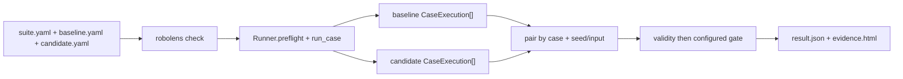
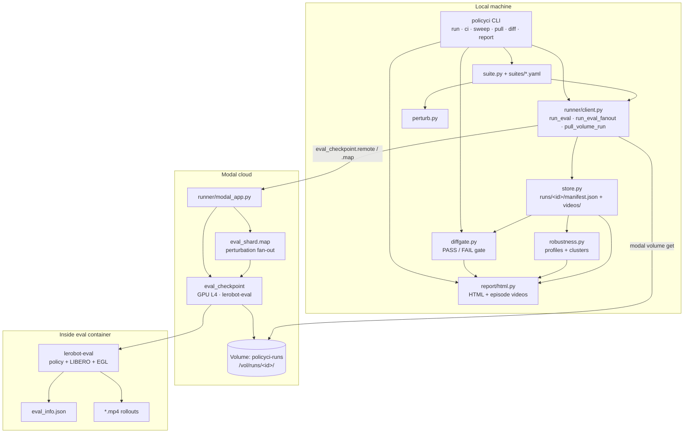
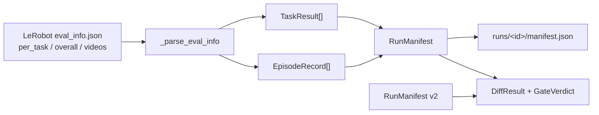
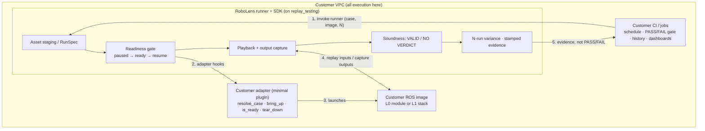

# RoboLens evaluation engine — architecture & code flow

The current product contract is runner-independent:

```text
baseline + candidate + protected cases
                  ↓
          PASS / BLOCK / NO_VERDICT
                  +
             paired evidence
```

The first implemented runner evaluates learned policies on **LeRobot / LIBERO** using Modal GPUs. The next runner adds bounded ROS 2 input replay. Both produce `CaseExecution`; the check engine owns pairing, validity precedence, gating, portable storage, and the static evidence page.

**Design rules:** wrap the runtime rather than reimplementing it; execution validity precedes behavior; and a missing or incomparable result is never green.

## Release-check flow



---

## Repo layout

```
policyci/
├── src/policyci/               # installable package (CLI: robolens; policyci alias)
│   ├── cli.py                  # check, robustness-check, visualize + legacy run/pull/diff/report/ci/sweep
│   ├── checkspec.py            # strict suite + subject YAML inputs
│   ├── check.py                # paired execution, comparison, gate, artifact tree
│   ├── robustness_check.py     # one subject across protected scenarios, absolute gate
│   ├── schemas.py              # CaseExecution/CheckResult plus legacy run/diff models
│   ├── store.py                # file-backed runs/ I/O (swap seam for Postgres/S3 later)
│   ├── diffgate.py             # pure v1 vs v2 regression diff + deploy gate
│   ├── suite.py                # YAML suite → list of Scenario shards
│   ├── perturb.py              # instruction / pose perturbation helpers + env wrappers
│   ├── robustness.py           # success-vs-level profiles + failure clustering
│   ├── mujoco_metrics.py       # exact-state placement / contact metrics
│   ├── visualization.py        # Rerun recordings for check evidence
│   ├── rerun_visualizer.py     # shared Rerun helpers
│   ├── *_rerun.py / *_visualization.py   # robustness, manipulation, ALOHA dashboards
│   ├── report/                 # HTML evidence (html.py + templates/)
│   ├── runner/
│   │   ├── base.py             # Runner protocol + PreflightResult
│   │   ├── libero.py           # exact-seed adapter to the Modal LIBERO evaluator
│   │   ├── modal_app.py        # Modal image, Volume, eval_checkpoint, fan-out
│   │   ├── client.py           # local callers: run_eval, pull_volume_run, materialize
│   │   ├── mujoco.py           # Robosuite / MuJoCo simulation runner
│   │   └── ros2_replay.py      # bounded ROS 2 MCAP input-replay runner
│   └── examples/               # reference subjects: mujoco_grasp, ros2_replay, aloha_replay
├── suites/                     # suite YAML specs
├── subjects/                   # subject YAML specs (baseline / candidate / controller)
├── examples/                   # Dockerfiles, fixtures and READMEs for the containerized demos
├── scripts/                    # demo wrappers, fixture prep, quantize helper
├── tests/                      # unit tests (no GPU / Modal); integration/ needs ROS 2 or MuJoCo
├── docs/robolens-check.md      # three-file check contract + portable result tree
├── runs/                       # local artifacts (gitignored)
├── ARCHITECTURE.md
├── README.md
└── pyproject.toml
```

`robolens check` writes one portable tree under `runs/<check_id>/`. Local legacy dry-runs write explicitly synthetic manifests. Live LIBERO evals write to Modal Volume `policyci-runs`, then materialize JSON and video artifacts into the check tree.

---

## Architecture diagram



### Data model (thin wrapper)



---

## Evaluation core

The evaluation core is **not** a custom rollout loop. It is a Modal worker that shells out to LeRobot’s official evaluator, then normalizes outputs into our schemas.

### 1. Entry: `eval_checkpoint` (`runner/modal_app.py`)

Runs on an L4 GPU container with EGL (`MUJOCO_GL=egl`), HuggingFace secret, and Volume mount at `/vol/runs`.

**Inputs:** policy Hub id/path, LIBERO suite name, task ids, episode count, seed, optional `perturbation` dict, optional `run_id`.

**Steps:**

1. Create `/vol/runs/<run_id>/` (+ `videos/`).
2. Ensure LIBERO `~/.libero/config.yaml` exists (avoids interactive first-import in containers).
3. Build and run:

   ```text
   lerobot-eval
     --policy.path=<policy>
     --policy.device=cuda
     --env.type=libero
     --env.task=<suite>
     --env.task_ids=[...]
     --eval.n_episodes=N
     --seed=...
     --output_dir=/vol/runs/<run_id>
     --policy.n_action_steps=10
   ```

4. Locate `eval_info.json` under the output dir.
5. `_parse_eval_info` → `tasks`, `episodes`, `overall_pc_success` (handles LeRobot’s nested `per_task` list / flat layouts).
6. Stamp perturbation metadata onto tasks/episodes when present.
7. Collect `*.mp4` under `videos/` with relative paths (`videos/...`).
8. Write `shard_result.json`, commit the Volume, return a result dict to the caller.

### 2. Fan-out: `eval_shard` + `.map()`

v1 sweeps expand a YAML suite into many **Scenario** shards (`suite.py`). Each shard is one `(task, axis, level, seed, n_episodes, perturbation)` job. `run_eval_fanout` calls `eval_shard.map(prepared)` so Modal runs them in parallel; results are aggregated into one sweep `RunManifest`.

### 3. Local materialization: `runner/client.py`

| Function | Role |
|----------|------|
| `run_eval` | `app.run()` → `eval_checkpoint.remote` → save manifest → `modal volume get` videos |
| `run_eval_fanout` | `.map()` shards → pull each shard → aggregate manifest |
| `pull_volume_run` | `modal volume get policyci-runs <run_id> …` into `runs/<id>/` |
| `materialize_run_from_result` | Dict → `RunManifest` on disk + optional pull |
| `ensure_local_manifest` | Rebuild `manifest.json` from `shard_result.json` after a bare pull |

Standalone pulls use the Modal CLI volume download (fast; no GPU image rebuild). `fetch_run_artifacts` remains as an in-app RPC fallback.

### 4. What we deliberately do *not* own

- Policy loading / inference / LIBERO physics / video encoding → **LeRobot**
- Persistent DB / object store → deferred; `store.py` is the seam

---

## Module reference

| Module | Responsibility |
|--------|----------------|
| **`cli.py`** | Typer app: `eval` / `ci -c` / `run` / `pull` / `diff` / `report` / `sweep`. |
| **`schemas.py`** | Shared contracts: `EpisodeRecord`, `TaskResult`, `RunManifest`, `TaskDiff`, `DiffResult`, `RobustnessProfile`, `FailureCluster`. |
| **`store.py`** | `save_run` / `load_run` / `save_diff` under `runs/`. Creates `videos/` and per-episode JSON. No business logic. |
| **`diffgate.py`** | Pure functions. Match tasks by `suite/task\|axis\|Llevel` (canonical `instruction`/`pose`). REGRESSED → FAIL. |
| **`suite.py`** | Flat `tests:` YAML (preferred) or legacy `axes:` → `Scenario` list; `GateConfig`; `normalize_axis`. |
| **`perturb.py`** | Instruction / pose wrappers (`wrap_env`); accepts canonical + legacy axis names. |
| **`robustness.py`** | From a sweep manifest: success-vs-level curves (`holds_until` / `breaks_at`) and failure clusters for the report. |
| **`report/html.py`** | Jinja template; discovers local `videos/**/*.mp4`; paths relative to the HTML file so `open report.html` plays videos. |
| **`runner/modal_app.py`** | Modal App, CUDA/EGL image build, Volume, `eval_checkpoint`, `eval_shard`, `fetch_run_artifacts`, local `--derisk` entrypoint. |
| **`runner/client.py`** | Mac/local side of Modal: invoke workers, pull Volume, write `runs/`. |

### Scripts & suites

| Path | Purpose |
|------|---------|
| `scripts/demo_offline.sh` | Flat eval + CI dry-run (FAIL) + legacy sweep → HTML |
| `scripts/quantize_policy.py` | Produce a degraded/quantized v2 checkpoint for demos |
| `suites/soup_basket.yaml` | Flat suite example (nominal + instruction + pose) |
| `suites/libero_object_robustness.yaml` | Legacy axes matrix (still supported) |

---

## End-to-end code flows

### A. Single eval (`policyci run` or Modal derisk)

```text
CLI / modal entrypoint
  → client.run_eval  OR  eval_checkpoint.remote
      → Modal GPU: lerobot-eval → Volume JSON + mp4
  → pull_volume_run (modal volume get)
  → store.save_run(manifest)
  → optional report
```

### B. CI gate (`policyci ci`)

```text
eval v1 → RunManifest₁
eval v2 → RunManifest₂
  → diffgate.diff_runs(v1, v2, threshold_pp=10, min_episodes=5)
  → store.save_diff
  → report.render_diff_report
  → process exit code = DiffResult.exit_code
```

Dry-run skips Modal and writes synthetic manifests (strong v1, regressed task on v2) so demos work offline.

### C. Suite eval / CI (`policyci eval` / `policyci ci -c`)

```text
load_suite_spec(yaml)   # flat tests: or legacy axes:
  → expand → Scenario[]
  → eval: run_eval_fanout(policy, shards)
  → ci:   fanout(v1) + fanout(v2) → diffgate (gate from YAML or CLI)
  → HTML report
```

### D. Pull existing cloud run (`policyci pull derisk_day1`)

```text
modal volume get policyci-runs derisk_day1 → runs/derisk_day1/
  → ensure_local_manifest (from manifest.json or shard_result.json)
  → attach relative video paths
  → optional HTML report with <video> tags
```

---

## Artifact layout

```text
runs/<run_id>/
  manifest.json          # RunManifest (source of truth for gate/report)
  eval_info.json         # verbatim LeRobot output when available
  shard_result.json      # Modal worker return payload (Volume-native)
  perturbation.json      # optional, if suite shard had a perturbation
  videos/**/*.mp4        # episode rollouts
  episodes/<id>.json     # per-episode records (RoboLens seam)
```

Volume mirror: same tree under Modal Volume `policyci-runs` (mounted as `/vol/runs` in workers).

---

## CLI map

| Command | Flow |
|---------|------|
| `policyci eval` | Suite YAML → scenarios → fan-out eval → report |
| `policyci run` | One checkpoint eval → `runs/<id>/` (pulls videos by default) |
| `policyci pull` | Volume → local only |
| `policyci diff` | Two runs → gate + optional report |
| `policyci report` | Render HTML from a run or diff dir |
| `policyci ci` | v1 + v2 (optional `-c` suite) → diff → report → exit code |
| `policyci sweep` | YAML suite fan-out → robustness report |

---

## Testing & offline demo

- Unit tests under `tests/` cover schemas/store, diffgate, suite/perturb, robustness, report/video paths — no GPU.
- `./scripts/demo_offline.sh` exercises the full local narrative (FAIL gate + robustness cliff HTML).
- Live path: `uv run modal run src/policyci/runner/modal_app.py --derisk --policy HuggingFaceVLA/smolvla_libero`.

Pinned decisions: lerobot 0.4.4, the openpi transformers fork, Modal from day one, no Postgres/S3 in v0/v1.

---

## Keystone — target product architecture

The MVP above (sim/policy on Modal) is **one runner**. The product — internally **Keystone** — is a **generic regression-CI control plane** with **pluggable runners**, sold to robotics teams. ROS 2 stacks use the **rosbag-replay** runner; our LIBERO/Modal work is the **sim/policy** runner; both share one control plane, gate, and reporting layer.

> **Design rule (the moat):** customer-specific logic lives only in (a) their runner image / adapter, or (b) config (`select.yaml`, `case.yaml`, metric plugins). It **never** leaks into the control plane, gate, or SDK. If you write `if module == "perception"` in core code, it belongs in config instead.

### System overview

```text
┌──────────────────────────────────────────────────────────────┐
│  CONSUMERS                                                    │
│  ┌ PR check ┐   ┌ Dashboard ┐   ┌ MCP (their coding agents) ┐ │
│  └────┬─────┘   └─────┬─────┘   └────────────┬──────────────┘ │
└───────┼───────────────┼──────────────────────┼────────────────┘
        └───────┬───────┴──────────────────────┘
                ▼
┌──────────────────────────────────────────────────────────────┐
│  CONTROL PLANE (ours · generic · multi-tenant)               │
│  REST API + MCP wrapper                                       │
│  ┌───────────┐ ┌───────────┐ ┌────────┐ ┌──────────────────┐ │
│  │ Selection │ │ Orchestr. │ │  GATE  │ │ Store / history /│ │
│  │ diff→case │ │ queue +   │ │ verdict│ │ telemetry (KPIs) │ │
│  │           │ │ parallel  │ │ engine │ │                  │ │
│  └───────────┘ └─────┬─────┘ └───▲────┘ └──────────────────┘ │
└──────────────────────┼──────────┼─────────────────────────────┘
             jobs (pull)│          │ run_meta.json (push)
                        ▼          │  outbound HTTPS only
┌──────────────────────────────────────────────────────────────┐
│  CUSTOMER VPC                                                 │
│  ┌ Keystone Agent (our daemon) ─────────────────────────────┐ │
│  │  poll queue → docker run <their-image> → post results    │ │
│  └───────────────┬──────────────────────────────────────────┘ │
│      ┌───────────┼───────────┐   (parallel, isolated workers) │
│      ▼           ▼           ▼                                 │
│   replay      replay      replay   ← their image runs our     │
│   worker      worker      worker     ReplayHarness SDK        │
│   + metric fns (their code, our SDK primitives)               │
│                                                               │
│   registry · rosbags · maps · cal   (never leave the VPC)     │
└──────────────────────────────────────────────────────────────┘
```

Three consumer surfaces, one control plane + gate, a thin **outbound** agent in the customer VPC. Raw data (bags, footage, maps) never leaves their network; only small `run_meta.json` (validity + metric values + artifact URI) comes back.

### Layered components

| Layer | Generic? | Owner | Notes |
|-------|----------|-------|-------|
| Consumers (PR check / dashboard / MCP) | ✅ | Us | All read the **same** gate verdict |
| Control plane (select · orchestrate · store · telemetry) | ✅ | Us | CPU-only; the reusable spine |
| **Gate** (validity → metrics → verdict) | ✅ | Us | Format-agnostic; consumes `{metric: value}` |
| **Runner contract** (`run(package, code_ref, level)`) | ✅ | Us | The interface every runner implements |
| **Replay framework / SDK** (`ReplayHarness`, `Bag`, reducers) | ✅ | Us | ~70% of hard replay work; reusable IP |
| **Agent** (job pull, docker run, isolation, report) | ✅ | Us | Ships into customer VPC |
| **Metric definitions + thresholds** | ❌ | Customer | Domain math; written on our SDK |
| **Runner adapter** (their topics/modules/bring-up) | ❌ | Customer | Lives in *their* image |
| **Config** (`select.yaml`, `case.yaml`) | ❌ | Customer | Declarative, not code |

---

### Control plane

Owns **what to run, when, and how the author (or agent) sees it** — not ROS internals or physics. **CPU-only**; it *assigns* work, it doesn’t *run* replays.

| Concern | Behavior |
|---------|----------|
| **Case registry** | ID, tags (module, severity, incident), package URI, metric set, owner, schedule eligibility |
| **Suite** | Named collection of cases (+ optional smoke subset) |
| **Schedules** | `pr` / `nightly` / `release` with different selectors and caps |
| **Selection** | Which cases fire for a given SHA / PR (diff → touched modules → cases) |
| **Orchestration** | Shard cases into jobs, enqueue, fan-out, retry, priority, timeout |
| **Gate** | Compute verdict from returned `run_meta` (see Gate) |
| **CI check** | One required status; only **PASS** merges |
| **Store / history** | Run records, verdicts, artifact URIs (URIs point into customer buckets) |
| **Telemetry** | Aggregate KPIs (see Telemetry) — **our** operational data, never their raw bags |

**Schedules (defaults)**

| Schedule | Selector | Cap |
|----------|----------|-----|
| **PR** | Affected modules + critical smoke | `max_cases` / `max_minutes`, high priority |
| **Nightly** | Full suite or stratified sample | Throughput; new cases soak here before hard-gate |
| **Release** | All cases (+ Orin L2 as evidence) | Completeness |

**Selection (impact map)** — generic, config-driven:

```yaml
# keystone.select.yaml  (customer repo; engine is generic)
modules:
  navigation:  { paths: ["ros/nav/**", "slam/**"], tags: [nav] }
  manipulation:{ paths: ["arm/**", "planner/**"],  tags: [manip] }
  perception:  { paths: ["perception/**", "vlm/**"], tags: [perception] }
smoke:
  tags: [critical]
```

PR diff → path globs → tags → case union + smoke. `Fixes: incident-1042` in the commit forces those cases. The report shows **why these N of M ran** (trust when green isn’t “we skipped everything”).

**API sketch** (the MCP layer wraps this same API):

```text
POST /suites/{id}/select   { git_diff | labels }        → case_ids[]
POST /runs                 { case_ids, code_ref, sched } → run_id
GET  /runs/{id}            → status, verdict, artifact URIs
GET  /runs/{id}/explain    → per-case metrics vs bounds, why FAIL/NO VERDICT
GET  /reports/{check_id}   → HTML / JSON for the PR
```

**Out of scope for the control plane:** DDS tuning, bag recording on the robot, training jobs, building the customer’s image.

---

### Orchestration & parallelism (agent + pull model)

We **orchestrate from outside**; replays **execute inside the customer VPC**. We never reach in — their agent reaches out.

- **Keystone Agent** runs in their VPC, makes **outbound HTTPS only** (poll for jobs, push results). No inbound ports, no VPN — the self-hosted-CI-runner pattern their security team already trusts.
- **We control** what runs, how many, priority, timeouts, retries, isolation. **They control** pool size and hardware shape.

**Parallelism primitives** (simple config for them; hard logic in our orchestrator):

```yaml
# keystone.workers.yaml  (customer)
pool:
  max_concurrent: 10           # replays at once (their compute budget)
  isolation: domain-per-job    # unique ROS_DOMAIN_ID per container
resources:
  l0: { cpu: 4,  gpu: false }
  l1: { cpu: 8,  gpu: true }   # whole-robot heavier
```

| Primitive | Set by | Enforced by |
|-----------|--------|-------------|
| Case-level fan-out (1 case ≈ 1 container) | **Us** (automatic) | Queue + agents |
| `max_concurrent`, resource shapes | Customer | Their pool |
| `isolation` (domain-per-job / host-per-job) | Us default; they override | Agent (sets `ROS_DOMAIN_ID` / one-run-per-host) |
| Priority (PR > nightly), timeout / latency cap | **Us** | Orchestrator / agent (kills → NO VERDICT) |
| Retry transient flake before NO VERDICT stands | **Us** | Orchestrator re-dispatch |

The **DDS collision hazard** (two replays sharing a host cross-talking on the same topics) is solved once in the agent (`domain-per-job` / `host-per-job`) so every ROS customer gets it free.

---

### Infra & compute — what runs where

A common misread is that we build a "replay cloud" in the customer VPC. **We don't.** There is no separate compute platform — replay runs *inside a container* (their image + our harness), and the "infra" to run it is a **queue + worker agents**, not Kubernetes or a bespoke scheduler.

**The only thing we deploy into the customer VPC is the agent** — a small long-running daemon (like a self-hosted CI runner). The customer provides the machines it runs on.

```text
YOUR CLOUD  (build once · serves every customer)
  control plane · queue · gate · store · dashboard · MCP · PR check
        │  jobs out ▲ results in   (HTTPS, agent-initiated)
        ▼           │
CUSTOMER VPC  (you deploy the agent; they provide the compute)
  ┌ Keystone Agent (your daemon, generic) ─────────────┐
  │  poll queue → docker run <their-image> replay-case  │
  │  enforce isolation → collect output → post run_meta │
  └─────────────────────────────────────────────────────┘
  their VM/GPU pool · Docker · fast disk · registry · buckets   ← they own
```

**What runs where:**

| Piece | Runs on | Provided/built by |
|-------|---------|-------------------|
| Control plane, queue, gate, dashboard, MCP | **Our cloud** | Us (build once, generic) |
| Keystone **agent** | Customer VPC | Us (generic daemon) — deployed onto their machines |
| Replay container (their image + our `ReplayHarness`) | Customer VPC | Their image + our SDK library |
| Compute (VMs/GPUs), Docker, disk, registry, buckets, IAM | Customer VPC | **Customer** (zero provisioning by us) |

**Parallelism = more agent workers, not autoscaling infra.** To run N replays at once, the customer runs N agent workers (or one agent launching N containers) on their pool; our control plane fans out N jobs into the queue and workers drain them. Day one this is a **queue + workers** pattern — no K8s, no autoscaler, no custom orchestration platform required. Scale later by adding workers (or wrapping the agent in their existing K8s if they want).

**How much of this is custom to any one customer?** Almost none:

| Component | Build effort | Customer-specific? |
|-----------|--------------|--------------------|
| Control plane | Real build, **once** | ❌ Generic |
| Agent | Moderate, **once** | ❌ Generic |
| `ReplayHarness` SDK (the hard part) | The real engineering, **once** | ❌ Generic ROS engine |
| `replay-case` adapter (topics, modules, bring-up) | Thin, per-customer | ✅ Co-built with them |
| Config (`select.yaml`, worker pool) | Trivial | ✅ Config, not code |
| Compute / provisioning / scaling hardware | — | ✅ Theirs |

The only customer-specific *code* is the thin adapter (their eng leads, we support). Everything expensive is **product reused across customers**.

**Where the effort actually goes** (not the "cloud infra" — that's a queue + a daemon):

1. The **`ReplayHarness`** — timing discipline, read-ahead, validity, output capture (the genuine engineering + moat).
2. The **agent's isolation + reliability** — non-colliding parallel replays (DDS domains), timeouts, retries.
3. The **first adapter integration** — the messy "it doesn't come up" week wiring their image into `replay-case`.

**Prerequisites we need from the customer** (agent + pool live in their VPC):

- VM/GPU pool with Docker + fast local disk; ability to run our agent
- Container registry + object buckets + IAM (agent pulls image, reads packages, writes results)
- Their image builds at a SHA and can install `keystone-runner`
- Rough parallel-worker budget (sets throughput)

**One-liner:** *We don't build a replay cloud. We build (a) a hosted control plane, (b) a lightweight agent on their machines, (c) a replay library inside their image. Parallelism = more agents on their pool. Compute, provisioning, and scaling hardware are theirs.*

---

### Gate (verdict engine)

Owns **PASS / FAIL / NO VERDICT** from returned artifacts. Deliberately **separate from the expensive run** — it consumes normalized `{metric: value}` + validity stats, never the raw bag, so the same gate serves replay, sim, and Orin.

**Two steps (always):**

1. **Validity — was the run sound?** For replay: worst inter-message gap, fraction of expected messages delivered, no stall beyond each topic’s tolerance — all computed on **message timestamps, not wall-clock**. If unsound → **NO VERDICT** (auto-retry transient flakes first).
2. **Quality — do metrics meet thresholds?** (only if validity passed). Reference-free behavior metrics + incident trip-wires + always-on safety invariants. Any gated breach → **FAIL**; all within bounds → **PASS**.

**Verdict model** (three states, **only PASS merges**):

| Code | Verdict | Meaning | Merge |
|------|---------|---------|-------|
| 0 | PASS | Every gated metric within bounds | ✅ merges |
| 1 | FAIL | A metric breached — regression or old bug returned | ❌ blocks — **fix the code** |
| 2 | NO VERDICT | Run unsound / couldn’t start (stall, missing artifact, provisioning gap) | ❌ blocks — **fix the setup, re-run** |

FAIL and NO VERDICT block for **different fixes**; neither merges. Transient flakes auto-retry before a NO VERDICT stands. Uncalibrated metrics run **warning-only** (reported, never block) until QA signs off the threshold.

**Threshold calibration:** a `keystone calibrate` command runs trusted code N times, measures each metric’s natural spread, and proposes a bound just outside it — automating threshold calibration.

**Verdict is the single source of truth.** PR check, dashboard, and MCP all *read* it; none compute their own pass/fail.

---

### Metrics & the SDK (customer owns math, we own primitives)

**The customer owns metric definitions and thresholds**; we own the SDK they write them on and the gate that judges them. We **never** compute metrics ourselves (no domain knowledge; would make us bespoke).

The SDK gives reusable primitives so they write ~5 lines of domain logic, not 50 of plumbing:

```python
from keystone_sdk import metric, invariant, Bag

@metric(name="planner_path_returned", kind="trip_wire")
def planner_returns_path(bag: Bag) -> float:
    return 1.0 if bag.topic("/planner/path").count() > 0 else 0.0

@metric(name="path_smoothness", kind="behavior")
def smoothness(bag: Bag) -> float:
    return bag.reduce.smoothness(bag.topic("/planner/path").last())

@invariant(name="no_safety_stop")            # always-on, blocks at every level
def safety(bag: Bag) -> bool:
    return bag.topic("/safety/stop").count() == 0
```

SDK surface we own (generic across every ROS customer):

| Primitive | What it solves |
|-----------|----------------|
| `Bag` | Clean, **message-timestamp-aware** topic access — kills the wall-clock trap once, for everyone |
| `bag.reduce.*` | Reference-free reducers: smoothness, coverage, agreement, timing/latency p95, margins, task-completion |
| `@metric(kind=behavior\|trip_wire)`, `@invariant` | Declares *what* a metric is so the gate treats it correctly (invariants always-on; new metrics warning-only) |
| validity handles | Stall/drop/gap stats from the harness, exposed for metric reuse |
| `keystone calibrate` | Auto-propose thresholds from measured spread |

**Where it computes:** metric functions run **in the customer VPC**, on the output bag, right after replay (bag is there, shouldn’t move). Only `{metric: value}` + validity → `run_meta.json` comes back to our gate. Computation (needs bag) vs judging (needs only values) stay cleanly split.

**Later (sugar, not first):** a declarative YAML metric form for the simple ~60% (trip-wires, `topic non_empty`, `latency < X`); complex metrics stay in the SDK.

---

### Runners

A **runner** turns one case into artifacts for the gate. All implement the same contract:

```text
run(package_uri, code_ref, level) →
  output_bag_uri            # stays in customer bucket
  run_meta.json             # { validity{…}, metrics{name:value}, status, artifact_uri }
```

**Runner 1 — rosbag replay (near-term).** The replay *framework* (`ReplayHarness`, buffering, clock, validity capture, output bag) is **ours and reusable**; the *adapter* (their topics, module list, bring-up order) lives in **their image** and calls our SDK:

```python
from keystone_runner import ReplayHarness
h = ReplayHarness(package="/package", out="/out")
h.seed_state(pose=..., map=...)                 # framework orders startup
h.start_playback(paused=True, read_ahead=...)   # our anti-stall buffering
h.start_module("perception", replay_mode=True)  # they name modules
h.wait_for_first_output()                       # never a fixed timer
h.start_clock()                                 # message-stamp based
h.run_until_end()                               # auto-captures output.bag + validity
```

Case package (input) — a bag alone can’t re-run software:

```text
package/
  rosbag/                 # trimmed window around the incident
  cal/ maps/ models/      # not in the bag; checksummed
  commands/               # captured or reconstructed request/reply
  manifest.yaml           # ids, topics, origin (robot, SW ver), digests
```

Levels and replay style:

| Level | Runs | Bag plays | Measures | Merge-gate? |
|-------|------|-----------|----------|-------------|
| **L0** | One module in isolation (remapped outs) | That module’s inputs | Per-module metrics | Yes |
| **L1** | Full stack integrated | Raw sensor/external inputs only; downstream live | Whole-robot metrics + roll-up | Yes |
| **L2** | Same as L1 on **Orin** | Same | L1 + on-target latency/memory | No (scheduled evidence) |

**Input replay** (bag feeds inputs, software computes **fresh** outputs) is the gate. **Full replay** (recorded outputs too) is debug-only.

**Runner 2 — sim/policy (our LIBERO/Modal work; later policy-promotion gates).** Same contract; emits `eval_info`-derived `{metric: value}`. This is where a **held-out evaluation set for policy promotion** eventually plugs in — a candidate policy clears the same gate before promotion.

**Runner 3 — Orin L2.** Same L1 recipe on-device; scheduled, non-blocking; adds on-target timing/memory metrics.

---

### Replay mechanism & visualization — ownership

"Replay" and "visualization" each split into a **generic part we own** and a **customer/existing-tool part we don't rebuild**. Getting this boundary right is what keeps us a product, not a bespoke integration or a Foxglove clone.

**Replay** splits into mechanics vs. wiring:

| Part | Owner | Why |
|------|-------|-----|
| Replay **mechanics** — read-ahead buffering, message-timestamp clock, stall/drop detection, output capture, the paused→seed→wait-for-ready→start-clock sequence | **Us** (`ReplayHarness` SDK) | ~70% of the hard work, identical for every ROS customer → reusable IP / moat. |
| Replay **wiring** — their topic names, module list, bring-up order, replay-mode flags, which topics are raw inputs at L1 | **Customer** (adapter in their image) | Only they know their stack |

We do **not** assume the customer builds the replay engine (that would leave us a thin dashboard with no defensibility), nor that we build all of it (we don’t know their topics). The SDK *is* the split.

**Visualization** splits into three tiers — we own only the cheap, generic one:

| Tier | Owner | Notes |
|------|-------|-------|
| **Report-level** — verdict table, metric-vs-threshold, pass/fail, trend/coverage plots | **Us** | This *is* the CI product; generic, high value |
| **Deep bag inspection** — scrub topics, cameras, TF, timelines | **Existing tools** (Foxglove / RViz / Rerun) | We **link to the output bag** (signed URL), never rebuild a bag viewer |
| **Failure understanding** — behavior timeline, “wrong object”, module attribution | **RoboLens (optional, later)** | Our other product’s edge; a separate opt-in track |

Net: we emit the **output bag + a report** (metric plots + verdict + signed URL); the customer opens the bag in **their existing viewer** for deep debug. The only place we add visualization *depth* is RoboLens, as an add-on.

### Observability (seeing pass/fail from outside the VPC)

We never see *into* their VPC — we see **callbacks and verdicts**:

```text
worker → output.bag (their bucket) + run_meta.json
  → agent POSTs run_meta (outbound)  { validity, metrics, status, artifact_uri }
  → gate: validity? → metrics vs thresholds → verdict (0/1/2)
  → roll-up across cases → one CI check
```

| Surface | Shows | Audience |
|---------|-------|----------|
| PR check | Single red/green + summary table | Their devs, on the PR |
| Dashboard / run record | Per-case validity, metrics vs bounds, verdict | Both |
| Artifact link | Signed URL to `output.bag` **in their bucket** | Their devs, local repro |
| Agent heartbeat | Worker alive, queue depth, stuck jobs | Us (ops) |
| Telemetry | Verdict/flake rates, latency, regressions caught | Both |

The one thing that stays put (the multi-GB bag) is exactly what we don’t need to move — we get its URI for their devs to fetch and debug locally.

---

### MCP layer (agent-native CI)

Wrap the control-plane API as **MCP tools** so the customer’s coding agents (Cursor / Claude Code) — the ones writing the code under test — can query and trigger Keystone. This makes **our gate the reward signal those agents optimize against**. It’s a thin wrapper over the same REST API and the same gate.

| Tool | Purpose |
|------|---------|
| `keystone_select(diff)` | Which cases will this change run? |
| `keystone_run(cases \| pr, code_ref)` | Trigger a run |
| `keystone_status(run_id)` | Verdict + per-case table |
| `keystone_explain(case_id, run_id)` | Why FAIL / NO VERDICT + which metric |
| `keystone_artifact(run_id)` | Signed URL to output bag for local debug |
| `keystone_list_incidents(status)` | Open vs fixed regressions |

Watch-outs: scope/rate-limit `keystone_run` (agents shouldn’t fire expensive L1 sweeps freely); keep MCP a **thin wrapper** (same API, same verdict); verdict source of truth stays the gate.

---

### Telemetry vs. customer data (what we retain)

We do **not** retain their raw bags — that adds integration weight, data-residency and IP risk, and little product gain. Their failure data stays in their VPC. We collect only **operational telemetry** about how Keystone performs, which doubles as their KPI dashboard and improves the platform across customers:

| We collect (safe, ours) | We never retain (theirs, sensitive) |
|-------------------------|-------------------------------------|
| Verdict rates (PASS/FAIL/NO VERDICT %) | Raw rosbags |
| Flake/retry & replay stall rates | Camera / lidar footage |
| Time-to-verdict, PR check latency | Site maps, calibration |
| Regressions caught before merge vs escaped | Their metric formulas |
| Which validity checks trip most | Failure-scene content |

Positioning: *“Your raw data never leaves your VPC — Keystone reads and replays it in place. We collect only operational telemetry to power your KPIs and improve the platform.”* If scrubbed, opt-in failure-clip retention ever becomes valuable (RoboLens triage), it is a **separate negotiated add-on**, never the default.

---

### What we build vs. what the customer owns

| Us (product · reusable) | Customer |
|-------------------------|-------------------|
| Control plane, orchestrator, queue, retries, priority | Compute pool size + hardware shapes |
| Gate / verdict engine + calibration | Metric definitions & thresholds (on our SDK) |
| Replay framework + SDK (`Bag`, reducers, `ReplayHarness`) | Runner adapter in their image (topics, modules, bring-up) |
| Agent (outbound pull, isolation, report) | Container registry, buckets, VPC |
| Selection engine | `select.yaml`, `case.yaml`, package contents + scrubbing |
| Dashboards, history, telemetry, MCP, PR check | Recording → incident → case authoring (named owner) |

**Explicitly a separate track:** physics-sim env generation from bags (real→sim / digital twin). When an env exists it becomes a **sim-runner** case under the *same* control plane — not a new product.

---

## RoboLens Replay — runner scope (built on `replay_testing`)

Concrete instantiation of the Keystone *rosbag-replay runner* for a customer ROS stack. Built on [`polymathrobotics/replay_testing`](https://github.com/polymathrobotics/replay_testing) (Apache-2.0): wrap `@fixtures → @run → @analyze`, spend engineering on **lifecycle + soundness validation**. The hosted CI path above stays for later product expansion.

### Boundary (we do not own PASS/FAIL)

The customer’s gate is two steps. We own only Step A; they own Step B and the merge verdict.

| Step | Meaning | Owner | Our output |
|------|---------|-------|------------|
| **A — Sound?** | Inputs delivered properly (message timestamps): gaps, delivered fraction, stalls, clock, readiness | **RoboLens** | `VALID` / `NO VERDICT` + reasons |
| **B — Expected output?** | Metrics vs thresholds + logical checks | **Customer** | Optional: raw metric/logical *values* via SDK primitives — **not** judged |
| **Gate** | Combine A+B → **PASS / FAIL** (only PASS merges) | **Customer CI** | We never emit PASS/FAIL |

Run and judging stay separate: we produce an **output bag** + soundness; the customer judges that file (re-runnable without replaying).

### Ownership (collapsed)

| RoboLens | Customer |
|----------|----------|
| Lifecycle + soundness validation; SDK primitives (`Bag`, reducers); help first adapter | Gate, thresholds, expected outputs; adapter long-term; cases/schema; recording |
| Runner image in their VPC | **CI/CD** (orchestrate, schedule, store, history, dashboards); execution; all raw data |

Design rules: opaque engine in VPC; minimal adapter; schema/message-agnostic; validate soundness — **do not** guarantee bit-exact determinism; **do not** own merge verdict.

### Replay styles (no sim required for input replay)

| Style | Bag plays | Stack does | Use |
|-------|-----------|------------|-----|
| **Input replay** (default) | Inputs only | Computes **fresh** outputs | Regression / gate path |
| **Full replay** | Inputs + recorded outputs | Debug / compare | Investigation only |

Input replay runs in a **container without a physics sim**: bag player + their ROS image (L0 module or L1 stack) + package assets (cal/maps/models/commands/warm-start). Requirement is an **off-robot runnable image**, not Gazebo/Isaac. Hardware-only or external-service deps constrain which L0/L1 scope is viable — they don’t force sim into the loop.

### Architecture



The adapter is a **plugin the runner loads and calls**, not a layer between CI and the runner. The runner owns lifecycle ordering; the adapter only resolves the case and brings up the customer image. The runner talks to the ROS graph directly for playback and capture.

### SDK surface

**CI → runner (inbound):** case path, adapter id, ROS image digest, repeat N, workers/isolation, out dir, run style (input | full).

**Runner → CI (outbound):** exit `0` sound / `2` NO VERDICT / `1` harness error; `run_result.json` (validity + provenance + optional metric *values*); output bag URI; static HTML. **No PASS/FAIL.**

**Adapter (expand any rosbag):** `resolve_case` → `RunSpec`; `bring_up(image)`; optional `is_ready`; `tear_down`. Engine unchanged across bags/robots — only the adapter + their case package change.

**Metric primitives (customer code, optional in-process):** `Bag`, reducers, value producers. Thresholds stay in the customer’s expected-output config. Prefer separate evaluate step so judging can re-run without replay.

**Parallelism:** CI fans out cases; runner exposes `--repeat` / `--workers` + `ROS_DOMAIN_ID` isolation for N-runs — not a second orchestrator.

### What we reuse vs. add (`replay_testing`)

| OSS | RoboLens |
|-----|----------|
| Fixture filter, bag play + clock, record, mcap reader | `RunSpec` staging, readiness gate (start-paused → resume), soundness engine, N-run aggregation, stamped evidence |

### Determinism & churn

- Guarantee: soundness on **message timestamps**; stamped, re-runnable results.
- Do not guarantee: bit-exact ROS replay. Offer variance levers + N-run stats; the customer’s thresholds judge distributions.
- Churn without us: schema-agnostic `resolve_case`; opaque message bytes; drift → NO VERDICT reason; `robolens doctor` for self-serve checks.

### Metadata & dashboards

- **Theirs:** full run records locally (feeds their CI history).
- **Ours (opt-in):** versions, validity reasons, fidelity signatures, hashed case shape — never bags/maps/formulas. `--dry-run-telemetry` prints the payload.
- **Dashboards:** the customer owns product UI. We ship static HTML as a CI artifact. Internal ops view later.

### Deliverables (lean)

pip SDK · one Docker image · compose file · signed license · CLI (`replay run`, `doctor`, report) → JSON + HTML. Pin result stamps always. Nothing customer-specific in the SDK.

### Success criteria (core)

1. Known-bad → customer gate FAIL; known-fixed → PASS (same input-replay case).
2. Broken setup → NO VERDICT, never behavior FAIL.
3. Customer CI invokes and reruns without RoboLens operating the run.

---

## RoboLens Replay — updates & long-term mechanism

Everything above is the initial scope. This is what comes *after*, in rough order.

### Updates: pull, pinned, never silent

Version bumps change results, so reproducibility requires **explicit** upgrades.

| Stage | Mechanism |
|-------|-----------|
| **Initial** | Manual `docker pull` of a **pinned tag** + pinned pip version |
| **Next** | **Release registry** — signed OCI images + PyPI on channels (`stable` / `beta`); the customer bumps deliberately; rollback = previous tag |
| **Later (opt-in)** | **Update agent** in their VPC: outbound HTTPS, "update available" *or* scheduled auto-update with health check + atomic rollback (the Datadog / GitHub-runner pattern) |
| **Air-gapped** | Quarterly offline bundle |

Every result stays stamped with (code SHA, case version, harness version, image digest), so a version change can never silently move a threshold.

### License & entitlement

Signed license file (expiry, feature flags, 30-day offline grace) verified by the engine — no inbound ports, works air-gapped. Expansion is a **new signed license**, not a redeploy. No serious DRM: enforcement is the contract plus the value of the release stream, not lockout.

### Sim expansion (same spine)

Replay and sim are two **stimulus backends** behind the *same* lifecycle → validation → aggregation spine, both co-located with the stack. Adding sim = a sim backend + scenario authoring; `RunSpec`, validation, N-run stats, provenance, CLI, and delivery are unchanged. This is the Stage-1 path (closed-loop eval, per-scenario-class sim↔real correlation tracking) — an extension, not a rebuild. Hosted GPU sim compute, if offered, is the natural metered unit.

### LLM-assisted RCA (premium, later)

The in-VPC engine calls LLMs through a **pluggable provider interface** (Anthropic, Gemini, or **BYO-endpoint** — Bedrock in their AWS, Vertex in their GCP) so failure context stays inside their compliance boundary. Prompts and pipelines live in the opaque engine and improve over the release channel.

### IP boundary (open-core)

| Open (adoption; no IP) | Closed (the moat) |
|---|---|
| Adapter **SDK** + `RunSpec` interface + conformance kit + reference adapters (built on Apache-2.0 `replay_testing`) | **Engine** (lifecycle discipline, validation, aggregation) as an **opaque image**; release / license / telemetry cloud; the compounding metadata |

The IP is never in the SDK — it's a plug shape, like the OpenAI/Anthropic clients.


## Future work (build next)

The Keystone spine above (control plane / gate / SDK / agent / runners) is the multi-customer product. The items below are the **sim/policy runner** and RoboLens depth that extend it — mostly relevant to open-benchmark customers and later policy-promotion gates.

### 1. Env backend seam (multi-sim + no-sim)

Split “what to run” (suite) from “where it runs” (backend):

```text
suite YAML + diffgate + store + report     ← keep stable
        │
   EnvAdapter / runner backend             ← build next
        │
   libero | isaac | custom_gym | real | replay
```

**Suggested YAML shape:**

```yaml
env:
  backend: libero          # libero | isaac | custom | real | replay
  suite: libero_object     # backend-specific task pack
  # robot: franka_panda
  # assets: package://... | s3://... | git+...
```

| Backend | Who it’s for |
|---------|----------------|
| `libero` (default) | Open-benchmark users; no internal sim required |
| `custom` / Gym-LeRobot | Companies with an existing env id / image |
| `real` | Hardware eval cell; same suite + gate, different runner |
| `replay` | Offline logged episodes; gate without new rollouts |

**Adapter contract (sketch):** resolve robot+assets → run N episodes → emit `eval_info`-compatible JSON + mp4s + `EpisodeRecord`s. Pin `backend_version`, `robot_id`, `asset_digest` on `RunManifest`.

### 2. Robot & asset packs

Today assets come from the LIBERO package/cache only.

Next:

- Versioned **asset packs** (URDF/MJCF, meshes, cameras, BDDL/tasks)
- Resolve from package / git LFS / S3
- Record digests on every run so v1 vs v2 cannot silently drift worlds
- Named robot profiles (`franka_panda`, …) with control-rate / action-dim metadata matching training

### 3. More perturbation axes

Engine first, then one YAML field (see suite design backlog): lighting, camera noise, occlusion, distractors, friction, joint jitter, action noise, latency, horizon. Reject unknown keys until implemented.

### 4. Sim → real faithfulness (don’t pretend LIBERO is a twin)

CI should **measure** fidelity, not claim it:

1. **Shadow / paired eval** — same policy on matched sim scenario + real episode; compare success *and* failure modes  
2. **Parity checks** — control rate, latency, action scaling, gripper events vs training  
3. **Domain-randomization stress** — gate if the policy only works on one lighting/pose draw  
4. **Calibration pack versioning** — fail CI when robot/scene digest changes unexpectedly  

Photorealism alone is not a fidelity gate; controller signals and embodiment parity matter as much as pixels.

### 5. RoboLens integration

policyci owns **scenarios + rollouts + relative `pc_success` gate**.  
RoboLens owns **why it failed** (video behavior, sensor anomalies, root-cause KB).

Next steps:

1. `PolicyCIParser` / format adapter over `runs/<id>/videos` + `episodes/*.json`  
2. Optional post-eval hook: `policyci analyze` → RoboLens pipeline  
3. Later gates on semantic criteria (e.g. fail if `wrong_target` in notable moments), keeping suite YAML free of assert DSL  
4. Use RoboLens pattern clusters to propose new suite tests / perturbation levels  

```text
policyci eval/ci → runs/
                     ├─ today: diffgate(pc_success)
                     └─ next:  RoboLens → richer FAIL + fix hints
                                     └─ real/sim shadow compare
```

### 6. Platform / ops (deferred)

- Postgres + object store behind `store.py`  
- Bake LIBERO assets into the Modal image  
- Live fan-out cost controls / quotas  
- Quantized v2 cloud verify + larger PI05 suite demos  

### Suggested build order

1. **`env.backend` interface** + keep `libero` as the first implementation  
2. **Manifest digests** (`robot_id`, `asset_digest`, `backend_version`)  
3. **RoboLens ingest hook** on existing `runs/`  
4. **`real` / `replay` backend** for companies without sim  
5. **Paired sim↔real + semantic gates**  
6. Extra sims (Isaac, …) and richer perturbation axes as adapters land  
