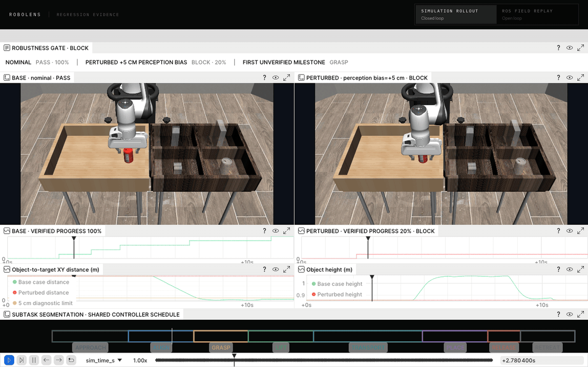
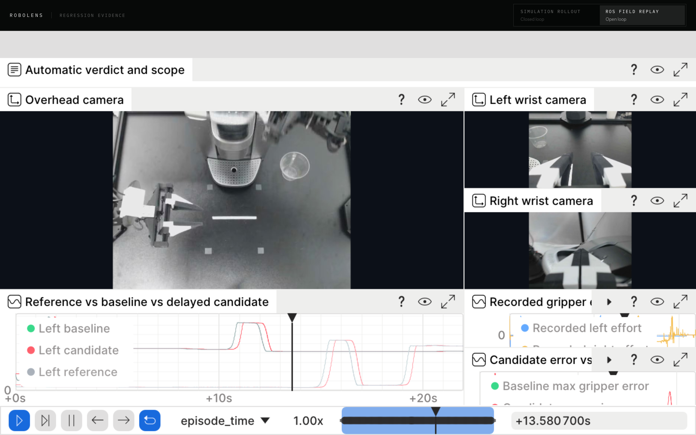

# PolicyCI

CI for robot policies and controllers. Turn simulator scenarios and recorded replays into deployment gates: run a baseline and a candidate on the same protected cases, decide `PASS`, `BLOCK`, or `NO_VERDICT` from exact simulator state or replayed outputs, and attach synchronized video and plots as evidence.

Two rules shape the design: execution validity is checked before behavior, and a missing or incomparable result is never green.

[](https://robolens.co/demo1)

Interactive Rerun recordings for both headline demos (closed-loop MuJoCo rollout and open-loop ALOHA ROS replay) are live at **[robolens.co/demo1](https://robolens.co/demo1)**.

## What it does

- **Release check** (`robolens check`): baseline vs candidate across the cases in a suite. Writes `runs/<check_id>/result.json` and `evidence.html`.
- **Robustness gate** (`robolens robustness-check`): one unchanged subject across protected perturbation scenarios, gated absolutely.
- **Rerun dashboards** (`robolens visualize`, `robolens robustness-visualize`): synchronized videos, exact-state metrics, and the verdict.
- **Runners**: Robosuite/MuJoCo simulation, LeRobot/LIBERO policy rollouts on Modal GPUs, and bounded ROS 2 MCAP input replay.

Gate exit codes are stable:

| Code | Result | Meaning |
|---:|---|---|
| 0 | `PASS` | All required cases were valid and no gate rule was violated |
| 1 | `BLOCK` | At least one valid required case failed its configured gate |
| 2 | `NO_VERDICT` | Required evidence was missing, invalid, or incomparable |
| 3 | Harness error | The suite, subject, or runner could not be configured |

## Install

Requires Python 3.10+ and [uv](https://docs.astral.sh/uv/). Docker is needed for the containerized demos; a Modal account plus a Hugging Face token are needed only for the LIBERO GPU path.

```bash
uv sync --extra dev          # core + tests
uv sync --extra visualize    # adds rerun-sdk for the dashboards
```

The package installs two equivalent CLIs: `robolens` and the legacy alias `policyci`.

## Demos

### 1. MuJoCo robustness gate (Docker, CPU only)

A scripted Panda pick-and-place controller runs across three protected scenarios. It passes the nominal case and a real 5 cm object shift because it retargets from the observed object pose. A third case injects a 5 cm object-localization bias: the controller grasps at the perceived pose, misses, and the gate blocks.

```bash
./scripts/run_mujoco_robustness_demo.sh runs/mujoco-robustness-demo
```

The first run builds a pinned CPU/OSMesa image (`robolens-mujoco-grasp:local`); later runs reuse it unless `ROBOLENS_REBUILD_IMAGE=1` is set. Rendering is software only, so expect roughly an hour on a laptop. A successful demonstration intentionally exits `1`: a valid protected scenario failed, so the gate blocked. The script verifies three 1280x720 videos, exact-state trajectories, controller and model identity, and the generated Rerun recording.

Reopen the dashboard later:

```bash
uv run robolens robustness-visualize /absolute/path/to/check_<id>
```

Rerun shows the base case beside the failed perturbation, the blocked verdict, all scenario results, object-to-target distance, placement success, and the full timeline. This is a scripted, object-state-aware controller test; it is not a VLA failure or a software-commit regression.

A related baseline-vs-candidate variant, where a 6 cm action-frame calibration error is fixed in the candidate, lives in [`examples/mujoco_grasp/`](examples/mujoco_grasp/README.md):

```bash
./scripts/run_mujoco_grasp_demo.sh runs/mujoco-grasp-demo
```

### 2. ALOHA replay gate (Docker + ROS 2)

Converts a pinned real LeRobot episode (`lerobot/aloha_static_coffee`, three cameras, joint position and effort) into a ROS 2 MCAP, then compares an unchanged action processor with a candidate that delays only the gripper commands by 300 ms:

```bash
./scripts/prepare_aloha_replay_fixture.sh          # builds the ROS 2 image, downloads and converts the episode
./scripts/run_aloha_replay_demo.sh runs/aloha-replay-demo
```

Expected output: baseline `PASS`, candidate `FAIL`, gate `BLOCK`. Rerun shows the three synchronized cameras, recorded joint effort, reference/baseline/candidate gripper commands, error against tolerance, and the first violation. This is open-loop component regression evidence, not a closed-loop prediction of what the robot would do. Details in [`examples/aloha_replay/`](examples/aloha_replay/README.md).

[](https://robolens.co/demo1)

### 3. ROS 2 Twist replay example (Docker)

Deterministic component replay of a recorded `/vehicle/cmd_vel` profile through a fixed baseline and a candidate that introduces a 0.4 m/s bias. The suite-owned tolerance is 0.05 m/s, so the candidate is marked `REGRESSED` and the gate blocks:

```bash
./scripts/run_ros2_replay_demo.sh runs/ros2-replay-demo
```

Details in [`examples/ros2_replay/`](examples/ros2_replay/README.md).

### 4. LIBERO policy check on Modal GPUs

Real closed-loop rollouts of two SmolVLA configurations (the example subjects deliberately differ in `n_action_steps`). This uses Modal GPU time.

```bash
modal secret create huggingface-secret HF_TOKEN=<your-hf-token>   # one time

uv run robolens check \
  --suite suites/manipulation-release.yaml \
  --baseline subjects/smolvla-baseline.yaml \
  --candidate subjects/smolvla-candidate.yaml
```

Default checkpoint: `HuggingFaceVLA/smolvla_libero`. PI05 (`lerobot/pi05_libero_finetuned_v044`) also works but requires accepting the gated `google/paligemma-3b-pt-224` license on Hugging Face with the same token.

### 5. Offline walkthrough (no GPU, no Docker)

Dry-run data, explicitly labeled synthetic, exercising the flat suite eval, the CI gate (expected `BLOCK`, exit 1), and a robustness sweep:

```bash
./scripts/demo_offline.sh
# writes runs/eval_report.html, runs/ci_report.html, runs/sweep_report.html
```

## Commands

| Command | What it does |
|---------|--------------|
| `robolens check --suite … --baseline … --candidate …` | Execute the release-decision contract and write paired evidence |
| `robolens visualize CHECK_DIR` | Open synchronized simulation video/state or replay traces in Rerun |
| `robolens robustness-check --suite … --subject …` | Run one subject across protected simulation scenarios and gate absolutely |
| `robolens robustness-visualize CHECK_DIR` | Compare the passing base case with a failed perturbation in Rerun |
| `policyci eval -c suite.yaml -p …` | Run flat (or legacy) suite scenarios for one policy |
| `policyci ci -c suite.yaml --v1 … --v2 …` | Same scenarios for two policies, then gate and report |
| `policyci run` / `policyci pull` | Eval one checkpoint on Modal / download JSON + mp4s from the Modal Volume into `runs/<id>/` |
| `policyci diff` / `policyci report` | Diff two run dirs into a verdict / render an HTML report |
| `policyci sweep` | Legacy perturbation matrix sweep (prefer `eval -c` for flat suites) |

The legacy `run`, `eval`, `ci`, and `sweep` commands accept `--dry-run` (explicitly synthetic data, no Modal). `check` and `robustness-check` have no synthetic mode: their evidence always comes from a real runner.

## Suite and subject files

A flat suite lists scenarios only; the gate is declared separately and can be overridden from the CLI:

```yaml
# suites/soup_basket.yaml
env: libero_object
episodes: 2
seed: 1000
gate:
  threshold_pp: 10
  min_episodes: 2
tests:
  - task: 0
  - task: 0
    instruction: "grab the soup can and put it into the basket"
  - task: 0
    pose_cm: 4.0
```

```bash
uv run policyci eval -c suites/soup_basket.yaml -p HuggingFaceVLA/smolvla_libero --dry-run
uv run policyci ci -c suites/soup_basket.yaml --v1 … --v2 … --dry-run
```

Subjects (`subjects/*.yaml`) pin what is under test with an `id`, an optional `checkpoint` or `code_sha`, and a `config` block (for example `n_action_steps` for a policy, `action_frame_offset_m` for the controller, or `gripper_delay_messages` for the ALOHA action processor). See [`docs/robolens-check.md`](docs/robolens-check.md) for the three-file contract, the portable result tree, and CI semantics.

## Repository layout

```
src/policyci/      package: check engine, runners, Rerun dashboards, HTML evidence, CLI
suites/            suite YAML specs
subjects/          subject YAML specs (baseline / candidate / controller)
examples/          Dockerfiles, fixtures, and READMEs for the containerized demos
scripts/           demo wrappers, fixture preparation, offline walkthrough
tests/             unit tests; tests/integration needs ROS 2 or MuJoCo and skips otherwise
docs/              check contract and README media
runs/              local artifacts (gitignored)
```

## Tests

```bash
uv run --extra dev pytest
```

The unit suite needs no GPU, Modal, Docker, or ROS 2. Integration tests under `tests/integration/` skip unless the matching runtime is available.

## Further reading

- [`ARCHITECTURE.md`](ARCHITECTURE.md): release-check flow, evaluation core, module map, runner contract, and future work.
- [`docs/robolens-check.md`](docs/robolens-check.md): suite, subject, and result file contracts.

## License

[MIT](LICENSE)
